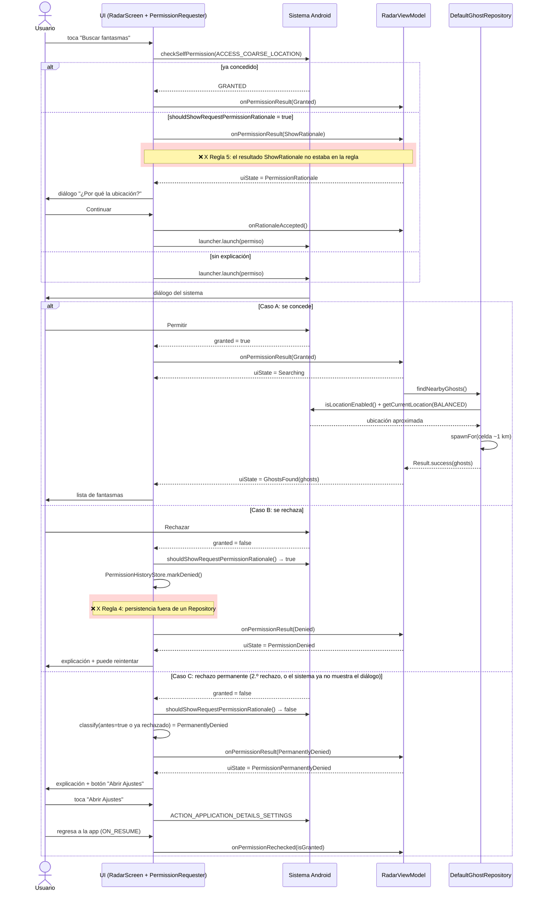
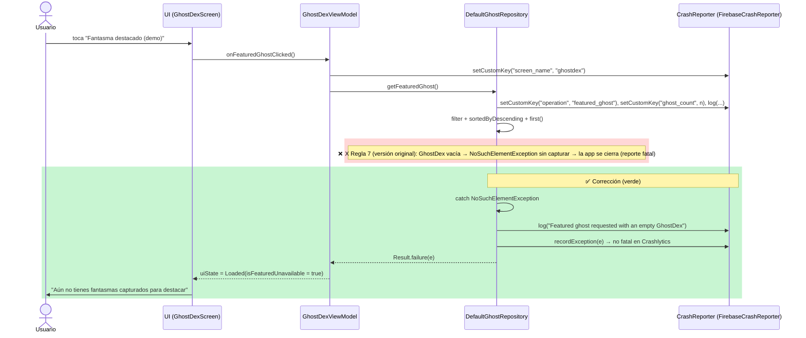

# Hoja de trabajo: Demo de permisos y Crashlytics

**App de demo:** Walking with Ghosts
**Integrantes:** Juan Carlos Espinal · Hector Eduardo Duarte · Jonathan Jorge Cofiño
**Asistente de IA:** Claude Code. Las instrucciones permanentes están en `CLAUDE.md`, en la raíz del proyecto.

---

## 1. Reglas para el asistente de IA

**Dónde viven y costo en tokens.** Según la guía de memoria de Claude Code, `CLAUDE.md` se carga en **cada sesión**.
La guía recomienda menos de 200 líneas porque los archivos largos "consumen más contexto y reducen la adherencia".
Por eso usamos 8 reglas de una o dos líneas.
Equivalente en Gemini: el archivo `AGENTS.md` (guía *Gemini in Android Studio: Best practices*).

| # | Regla (redacción final) | Lectura |
|---|---|---|
| 1 | Nombres de clases, funciones y variables en inglés: PascalCase para tipos, camelCase para funciones y propiedades, UPPER_SNAKE_CASE para constantes; `val` por defecto y sin `!!`. | Kotlin coding conventions (Naming rules) |
| 2 | Un tipo público principal por archivo, con el mismo nombre; paquetes por capa: ui.<pantalla>, data.*, domain.model, permissions, crash. | Kotlin coding conventions (Source code organization) |
| 3 | MVVM: cada pantalla tiene un ViewModel que expone un único StateFlow<UiState> inmutable; la UI solo renderiza y envía eventos; el ViewModel no guarda Activity, Context ni View. | Guide to app architecture (UI layer, UDF) |
| 4 | Los datos del juego (ubicación, colección y generación de fantasmas) solo se acceden desde un Repository detrás de una interfaz, recibido por constructor; un componente genérico puede guardar su propio estado interno. **(reescrita, ver 2.3)** | Guide to app architecture (Data layer, DI) |
| 5 | Todo permiso peligroso se solicita solo a través del componente genérico de permissions/, que recibe el permiso como parámetro y sigue el flujo oficial: devuelve Granted, ShowRationale, Denied o PermanentlyDenied. **(reescrita, ver 2.3)** | Guide to app architecture (Separation of concerns) |
| 6 | Solo FirebaseCrashReporter importa Firebase Crashlytics; el resto depende de la interfaz CrashReporter. Nunca enviar coordenadas ni datos personales. | Guide to app architecture (Separation of concerns) |
| 7 | Nada de catch vacíos: los errores de datos se capturan en el Repository, se registran con CrashReporter y se devuelven como Result para mostrar un estado seguro. | Guide to app architecture (Data layer: exposing errors) |
| 8 | Pedir los cambios por pasos y verificar cada uno compilando (`gradlew assembleDebug`) y con pruebas antes de continuar; no aceptar versiones de dependencias sin fuente oficial. | Gemini best practices (sequential prompts, verify each step) / guía de memoria de Claude Code |

> PENDIENTE DE VERIFICACIÓN: confirmar textualmente las secciones citadas de *Kotlin coding conventions* y *Guide to app architecture* (reglas 1–7) antes de entregar.

### Consulta con la que se solicitó la función
La consulta **real** fue el documento de especificación que el equipo le pasó a Claude Code (secciones 4.1 "Radar paranormal" y 6 "Permisos").
Después se le indicó "Comienza la Fase 1" y "sigue con el resto de las fases".
Esta es una versión resumida **derivada de esa consulta**; no es una transcripción literal:

> «En Walking with Ghosts (Kotlin, Compose, MVVM), agrega a RadarScreen un botón "Buscar fantasmas" que solicite
> ACCESS_COARSE_LOCATION con un componente genérico de permisos (ActivityResultContracts.RequestPermission).
> Si se concede, el RadarViewModel pide al GhostRepository los fantasmas cercanos a partir de la ubicación aproximada real
> (FusedLocationProviderClient). Maneja permiso concedido, rechazado (explicación y reintento) y rechazado de forma permanente
> (explicación y botón explícito a Ajustes; volver a comprobar al regresar). Trabaja por pasos y compila al final de cada uno.»

Siguiendo la guía de Gemini, la consulta nombra la pantalla, las APIs y los criterios de aceptación, y pide trabajar en pasos que se verifican uno a uno.

---

## 2. Permiso y arquitectura

**Permiso y tipo:** `ACCESS_COARSE_LOCATION`, permiso **de tiempo de ejecución** (en *Permissions on Android* se distingue de los de instalación y los especiales).
**Acción del usuario:** el jugador toca **"Buscar fantasmas"** en el radar paranormal. La app no lo pide al iniciarse.

### 2.1 Diagrama de secuencia (código real)
Las ❌ marcan dónde el código generado incumplía una regla (ver 2.2).

Para exportarlo como imagen: pegar el bloque en https://mermaid.live → *Actions* → PNG/SVG.

### 2.2 Auditoría del código contra las reglas
Método: revisión manual de cada archivo, más búsquedas (`!!`, imports de `android.content/app/view` en `*ViewModel.kt`, imports de `firebase.crashlytics`), compilación y pruebas.

| Regla | Resultado | Evidencia |
|---|---|---|
| 1 | Cumple | No hay `!!` en `app/src/main` |
| 2 | ❌ Incumplía: `CaptureUiState.kt` declaraba también `enum class CapturePhase` | Corregido: se movió a `CapturePhase.kt` |
| 3 | Cumple | Ningún ViewModel importa `Context`, `Activity` ni `View` |
| 4 | ❌ Incumplía: `PermissionHistoryStore` usa DataStore desde `permissions/`, fuera de un Repository | Se reescribió la regla (ver 2.3) |
| 5 | ❌ Incumplía: el componente devuelve también `ShowRationale`, que la regla no contemplaba | Se reescribió la regla (ver 2.3) |
| 6 | Cumple | Solo `crash/FirebaseCrashReporter.kt` importa Crashlytics |
| 7 | ❌ Incumplía en `DefaultGhostRepository.getFeaturedGhost()`: `.first()` sin capturar sobre una lista que podía estar vacía (el error a propósito) | Corregido en la Fase 7 (ver 3) |
| 8 | Cumple | `assembleDebug` y `testDebugUnitTest`: 8/8 pruebas correctas |

### 2.3 Reglas reescritas
- **Regla 4.** *Antes:* «Ubicación, persistencia y generación de datos solo desde un Repository…». *Ahora:* «Los datos del juego (ubicación, colección y generación de fantasmas) solo se acceden desde un Repository…; un componente genérico puede guardar su propio estado interno.»
  Motivo: el historial de rechazos es parte del componente de permisos. Llevarlo a un Repository acoplaría un componente genérico a la app.
- **Regla 5.** *Antes:* «…devuelve Granted, Denied o PermanentlyDenied». *Ahora:* «…sigue el flujo oficial: devuelve Granted, ShowRationale, Denied o PermanentlyDenied.»
  Motivo: *Request runtime permissions* indica mostrar una explicación cuando `shouldShowRequestPermissionRationale()` devuelve true.

---

## 3. Un error a propósito y su cierre

**Procedimiento (secreto):** un integrante elige el error y lo deja en la versión de demostración sin decir dónde está. Los otros dos solo usan el panel de Crashlytics.
1. Ejecutar la app (debug) y provocar el cierre con la acción de demostración.
2. **Volver a abrir la app.** Según *Get started*, el reporte se envía al reiniciar.
3. Esperar unos minutos y abrir Crashlytics → *Issues*.

| Campo | Resultado (copiar del reporte real) |
|---|---|
| Excepción | PENDIENTE DE VERIFICACIÓN |
| Archivo y línea | PENDIENTE DE VERIFICACIÓN |
| Causa | PENDIENTE DE VERIFICACIÓN |
| Claves personalizadas vistas (`screen_name`, `operation`, `ghost_count`) | PENDIENTE DE VERIFICACIÓN |
| Logs vistos | PENDIENTE DE VERIFICACIÓN |

**Corrección (implementada y compilada el 29/10).**
- `GhostRepository.getFeaturedGhost()` ahora devuelve `Result<Ghost>`.
- En `DefaultGhostRepository`, la búsqueda del fantasma destacado está dentro de `try`. Si salta `NoSuchElementException`:
  - escribe un log con `CrashReporter.log(...)`;
  - la registra como **no fatal** con `CrashReporter.recordException(...)`;
  - devuelve `Result.failure`.
- Antes de la operación ya se fijan las claves `operation=featured_ghost` y `ghost_count`. El ViewModel fija `screen_name=ghostdex`.
- `GhostDexViewModel` convierte el fallo en `isFeaturedUnavailable = true`. La UI muestra «Aún no tienes fantasmas capturados para destacar» y la app sigue funcionando.

**¿En qué capa se captura?** En el **Repository** (capa de datos).
- Ahí ocurre la operación sobre la colección, y la *Guide to app architecture* indica que la capa de datos expone los errores a las capas superiores.
- El ViewModel no necesita conocer la excepción concreta: solo recibe un `Result` y lo convierte en estado de UI (regla 7).
- `FirebaseCrashlytics` no se usa directamente: se llama a la interfaz `CrashReporter` (regla 6).

**Incumplimiento asociado (auditoría):** el código original violaba la **regla 7**, porque usaba `.first()` sobre una lista que podía estar vacía y no capturaba la excepción. Se marca ❌ en el diagrama y se corrige en verde.

**Verificación de la corrección**
| Comprobación | Estado |
|---|---|
| Compila y pasan las pruebas unitarias (8/8) | PROBADO |
| Con capturas, el botón muestra el destacado sin errores | PROBADO (emulador, 29/10: «Destacado: Alma del Bosque», mismo PID antes y después) |
| Con GhostDex vacía la app **no** se cierra | PROBADO (29/10: mismo PID, mensaje seguro, «log non-fatal event to persistence») |
| El no fatal aparece en Crashlytics con claves y logs | PENDIENTE DE VERIFICACIÓN (consola) |

### Flujo del equipo para atender un error de Crashlytics (propuesta)
| # | Paso | Responsable |
|---|---|---|
| 1 | **Detectar y priorizar.** Revisar el panel cada día. Prioridad alta: fatal, muchos usuarios o versión nueva; media: no fatal frecuente; baja: el resto. | Jonathan Jorge Cofiño |
| 2 | **Registrar.** Abrir un GitHub Issue con el enlace al issue de Crashlytics, la versión, la excepción, el archivo y la línea, las claves, los logs y la prioridad (etiqueta). | Jonathan Jorge Cofiño |
| 3 | **Reproducir.** Usar las claves y logs del reporte para repetir el fallo y escribir una prueba que falle. | Juan Carlos Espinal |
| 4 | **Corregir.** Rama `fix/<issue>` y un PR que cite el issue. La excepción se captura en la capa correcta y se registra como no fatal si aplica. | Hector Eduardo Duarte |
| 5 | **Revisar y verificar.** Revisión de código, pruebas y una **versión nueva** (`versionCode` + 1). Comprobar en Crashlytics que esa versión ya no reporta el fallo. | Juan Carlos Espinal |
| 6 | **Cerrar y vigilar.** Cerrar el issue en Crashlytics y en GitHub. Si reaparece, Crashlytics lo marca como **regressed**: «An issue has had a regression when you've previously closed the issue…» y lo **reabre automáticamente** (*Crashlytics troubleshooting & FAQ*). En ese caso se reabre el GitHub Issue y se vuelve al paso 3. | Jonathan Jorge Cofiño |

Las asignaciones son una propuesta; el equipo debe confirmarlas.

---

## 4. Guion de la demo (≤ 5 min)
| Tiempo | Quién | Qué mostrar |
|---|---|---|
| 0:00–0:40 | Héctor | App + `CLAUDE.md` (8 reglas, tokens) + estructura MVVM |
| 0:40–2:10 | Juan Carlos | Recorrer el diagrama: casos A, B y C en vivo (radar, rechazo, Ajustes) y `PermissionRequester` |
| 2:10–2:40 | Juan Carlos | Auditoría: las ❌ y las reglas 4 y 5 reescritas |
| 2:40–4:10 | Jonathan | Panel de Crashlytics: issue fatal (excepción, archivo, línea, claves, logs), luego el no fatal tras la corrección |
| 4:10–5:00 | Héctor | Capa donde se captura la excepción + flujo del equipo + issue *regressed* |

**Preguntas probables del docente**
- *¿Cómo detectan el rechazo permanente?* Android no tiene API para eso: se combina la explicación antes y después de la solicitud con un historial persistente (`PermissionDenialClassifier`, con 4 pruebas unitarias).
- *¿Por qué el componente está en la UI?* `registerForActivityResult` está ligado al ciclo de vida de la Activity; el ViewModel no debe guardar Context.
- *¿Por qué una interfaz para Crashlytics?* Para cambiar de implementación (Logcat o pruebas) sin tocar el resto, y para que solo un archivo dependa de Firebase.
- *¿Cuándo llega el reporte?* El fatal se envía al reiniciar la app; puede tardar unos minutos.
